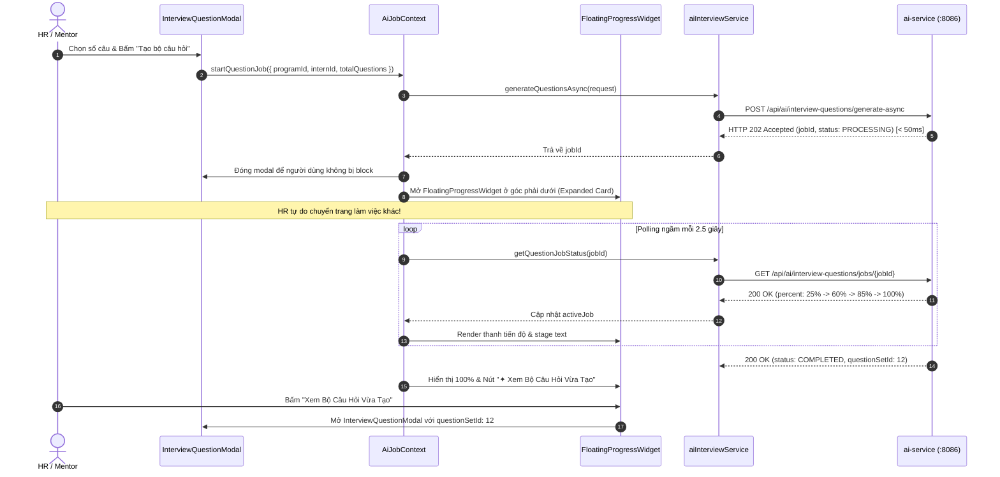

# Specification: Giao Diện AI Sinh Bộ Câu Hỏi Phỏng Vấn & Cửa Sổ Tiến Độ Nền Toàn Cục (TM-104 Frontend)

> **Tài liệu Đặc Tả Kỹ Thuật (Frontend Specification)**  
> **Dự án:** [InternHub-Frontend](file:///d:/codegym_final_project/InternHub-Frontend) (React 19, Vite, TypeScript, CSS Modules)  
> **Mã Jira Ticket:** [TM-104](https://robluccibn9935.atlassian.net/browse/TM-104) - *AI-Powered Interview Question Generator & Non-blocking Floating Progress Indicator*  
> **Trạng thái:** IMPLEMENTING (v1.0)  
> **Lưu trữ tại:** [`InternHub-Frontend/docs/specs/TM-104-ai-interview-question-frontend-spec.md`](file:///d:/codegym_final_project/InternHub-Frontend/docs/specs/TM-104-ai-interview-question-frontend-spec.md)  
> **Change Level:** **L3** (Tích hợp AI Interview Question Copilot: Sinh bộ câu hỏi 2 tầng Program/Candidate dựa trên JD & CV & AI Screening Dossier, Cơ chế xử lý đa luồng chạy ngầm Non-blocking tương tự TM-103, Tự động kích hoạt Cửa sổ tiến độ nổi `FloatingProgressWidget` góc phải dưới màn hình, Modal biên tập 3 nhóm câu hỏi chuyên sâu và xuất PDF Phiếu phỏng vấn).  
> **Tiêu chuẩn tuân thủ:** 35 Nguyên tắc bất biến ([`AGENTS.md`](file:///d:/codegym_final_project/InternHub-Frontend/AGENTS.md)), Quy chuẩn UX/UI ([`08-ui-ux-guidelines.md`](file:///d:/codegym_final_project/InternHub-Frontend/.agents/08-ui-ux-guidelines.md)) & Kỹ năng Thiết kế Giao diện Độc bản ([`frontend-design`](file:///d:/codegym_final_project/InternHub-Frontend/.agents/skills/frontend-design/SKILL.md)).

---

## 0. Nhật Ký Thay Đổi & Giải Trình Kỹ Thuật (Revision History & Change Rationale)

| Phiên bản | Ngày | Người thực hiện | Task / Jira | Loại thay đổi | Lý do & Giải trình kỹ thuật (Rationale) |
| :---: | :---: | :---: | :---: | :---: | :--- |
| **v1.0** | 2026-10-26 | AI Senior Frontend Pair-Programmer & User | `TM-104` | Tạo mới Đặc Tả Frontend | Khởi tạo tài liệu đặc tả kỹ thuật Frontend cho tính năng AI sinh bộ câu hỏi phỏng vấn; tích hợp cơ chế đa luồng chạy ngầm không chặn (Non-blocking Async Job) tương tự TM-103; khi người dùng bấm tạo, cửa sổ nổi `FloatingProgressWidget` (Expanded Card & Collapsed Pill) tự động mở ở góc phải dưới màn hình; kết nối tự động với `AiJobContext` và `InterviewQuestionModal`. |

---

## 1. Feature Overview (Tổng Quan Tính Năng)

- **Tên tính năng:** Giao diện AI sinh bộ câu hỏi phỏng vấn & Cửa sổ tiến độ nền toàn cục (AI Interview Question Generator UI & Global Floating Progress Indicator).
- **Hệ thống liên quan:**
  - **Frontend:** `InternHub-Frontend` (React 19, TypeScript, CSS Modules, Lucide React, Axios client).
  - **Backend API:** `ai-service` (Port `8086`) định tuyến qua API Gateway (Port `8080`) tại prefix `/api/ai/interview-questions/**`.
  - **Core Service:** `intern-and-program-service` (Port `8082`) cung cấp thông tin JD kỳ thực tập, hồ sơ ứng viên và tệp CV.
- **Điểm truy cập trên giao diện (Entry Points):**
  - Không gian quản lý chương trình thực tập (`HrProgramWorkspacePage.tsx`): Nút *"Sinh Bộ Câu Hỏi Khung"* (Program Scope).
  - Không gian thẩm định hồ sơ ứng viên (`ApplicationsTab.tsx` hoặc `CandidateWorkspaceModal.tsx`): Nút *"Phỏng Vấn AI"* (Candidate Scope).
  - Khung ứng dụng toàn cục (`App.tsx`): Widget tiến trình nền ghim cố định ở góc phải dưới (`FloatingProgressWidget.tsx`).
  - Modal biên tập và chốt bộ câu hỏi: `InterviewQuestionModal.tsx`.
- **Đối tượng người dùng & Phân quyền:** `ROLE_HR`, `ROLE_MENTOR`, `ROLE_ADMIN`.

---

## 2. Business Goal & Core Objectives (Mục Tiêu Nghiệp Vụ)

1. **Chuẩn hóa chất lượng phỏng vấn & Cá nhân hóa theo CV:**
   - Hỗ trợ 2 phạm vi: Sinh câu hỏi khung tiêu chuẩn theo kỳ thực tập (Program Scope) hoặc sinh câu hỏi cá nhân hóa chuyên sâu dựa trên CV ứng viên và hồ sơ thẩm định AI Screening Dossier (chất vấn các kỹ năng còn thiếu `missingSkills` và điểm đáng ngờ `redFlags`).
2. **Trải nghiệm Đa Nhiệm Không Chặn (Non-Blocking Multi-Tasking UX tương tự TM-103):**
   - Quá trình sinh 6 - 9 câu hỏi chi tiết qua Gemini LLM mất từ 10 - 25 giây. Việc đóng băng modal khiến người dùng khó chịu và giảm hiệu suất công việc.
   - **Cơ chế TM-103 chuẩn hóa:** Khi người dùng bấm *"Tạo bộ câu hỏi"*, modal cấu hình lập tức đóng lại (hoặc thu nhỏ), gửi request `POST /api/ai/interview-questions/generate-async`, nhận `HTTP 202 Accepted` kèm `jobId` trong `< 50ms`.
   - **Tự động kích hoạt Cửa sổ tiến độ nổi (`FloatingProgressWidget`):** Cửa sổ nổi tự động bung ra ở góc phải màn hình (`bottom: 24px; right: 24px; z-index: 1000`) ở trạng thái Mở rộng (Expanded Card), hiển thị giai đoạn thực thi thời gian thực (`percent` và `currentStage`).
   - Người dùng hoàn toàn tự do chuyển tab, chuyển trang, duyệt ứng viên khác trong khi AI chạy ngầm.
3. **Phân loại 3 Trụ Cột Câu Hỏi Khoa Học:**
   - `TECHNICAL_FOUNDATION`: Kiến thức nền tảng công nghệ theo vị trí.
   - `PROJECT_DEEP_DIVE`: Câu hỏi đào sâu dự án thực tế khai trong CV.
   - `BEHAVIORAL_AND_CULTURE_FIT`: Kỹ năng mềm, xử lý tình huống và văn hóa làm việc.
4. **Hành động Chuyển tiếp Tức thì Sau Hoàn Tất (Completion Action):**
   - Khi tiến trình hoàn thành (`percent === 100` / `status === 'COMPLETED'`), `FloatingProgressWidget` hiển thị nút trực diện: **`[ ✦ Xem Bộ Câu Hỏi Vừa Tạo ]`**. Bấm nút này sẽ mở thẳng `InterviewQuestionModal` với bộ câu hỏi vừa được tạo.

---

## 3. Khảo Sát Hiện Trạng & Đánh Giá Tái Sử Dụng Mã Nguồn (Mandatory Scan & Reuse Assessment)

> [!IMPORTANT]
> Tuân thủ triệt để Chỉ thị cốt lõi của Frontend: **"ĐẢM BẢO SẼ QUÉT DỰ ÁN, TRÁNH VIỆC TẠO THÊM CODE MỚI KHÔNG CẦN THIẾT, SỬ DỤNG TỐI ĐA NHỮNG GÌ ĐÃ CÓ ĐỂ PHÁT TRIỂN"** (Rule 16).

### 3.1. Các thành phần Frontend hiện hữu được tái sử dụng 100%

1. **[FloatingProgressWidget.tsx](file:///d:/codegym_final_project/InternHub-Frontend/src/components/common/FloatingProgressWidget/FloatingProgressWidget.tsx):**
   - Tái sử dụng trọn vẹn component thanh tiến độ nổi góc màn hình đã hoàn thiện ở TM-103 (gồm cả 2 chế độ: Collapsed Pill và Expanded Card, hiệu ứng Sparkles spin, thanh gradient shimmer, và các nút thu nhỏ/đóng).
   - Mở rộng để hiển thị linh hoạt tiến trình cho cả 2 nghiệp vụ: *"Tiến Trình Thẩm Định AI"* (Screening) và *"Tiến Trình Sinh Câu Hỏi Phỏng Vấn AI"* (Interview Questions).
2. **[AiJobContext.tsx](file:///d:/codegym_final_project/InternHub-Frontend/src/contexts/AiJobContext.tsx):**
   - Tái sử dụng hạ tầng Context quản lý polling ngầm tự động (2.5s/lần), xử lý timeout, dọn dẹp timer `clearTimeout` chống rò rỉ bộ nhớ (memory leak).
   - Bổ sung hàm `startQuestionJob(...)` hoặc mở rộng payload để điều phối tiến trình sinh câu hỏi.
3. **[InterviewQuestionModal.tsx](file:///d:/codegym_final_project/InternHub-Frontend/src/pages/hr/programs/workspace/components/InterviewQuestionModal.tsx):**
   - Tái sử dụng toàn bộ giao diện xem danh sách câu hỏi theo 3 nhóm tab, accordion hiển thị rubric & câu trả lời kỳ vọng, chức năng chỉnh sửa câu hỏi trực tiếp, đổi câu hỏi (regenerate), in ấn và sao chép.
   - Thay thế luồng sinh câu hỏi đồng bộ blocking cũ bằng việc kích hoạt `startQuestionJob`, đóng modal và nhường quyền điều khiển cho `FloatingProgressWidget`.
4. **Hạ tầng Design Tokens & CSS Variables:**
   - Tái sử dụng 100% hệ thống màu ngữ nghĩa từ [src/index.css](file:///d:/codegym_final_project/InternHub-Frontend/src/index.css) (`var(--primary)`, `var(--primary-glow)`, `var(--bg-card)`, `var(--border-default)`, `var(--text-main)`, `var(--text-muted)`). Cấm tuyệt đối mã màu Hex hardcode.
5. **Thư viện & Common UI:**
   - Tái sử dụng `Button`, `Modal`, `Badge` từ `src/components/common/`.
   - Tái sử dụng `sonner` (`toast.success`, `toast.error`, `toast.info`) và icon từ `lucide-react`.

### 3.2. Các thành phần tạo mới và mở rộng theo chuẩn Domain-Driven Modular

1. `src/constants/endpoints/ai.endpoints.ts`: Khai báo thêm các endpoint sinh câu hỏi async:
   - `INTERVIEW_GENERATE_ASYNC: '/api/ai/interview-questions/generate-async'`
   - `INTERVIEW_JOB_STATUS: (jobId: string) => '/api/ai/interview-questions/jobs/' + jobId`
2. `src/types/aiInterview.types.ts`: Khai báo thêm DTO:
   - `QuestionGenerationJobResponse`: Chứa thông tin `jobId`, `percent`, `currentStage`, `status`, `questionSetId`.
3. `src/services/aiInterviewService.ts`: Bổ sung method:
   - `generateQuestionsAsync(data: GenerateQuestionsRequest): Promise<QuestionGenerationJobResponse>`
   - `getQuestionJobStatus(jobId: string): Promise<QuestionGenerationJobResponse>`

---

## 4. Ngôn Ngữ Thiết Kế Độc Bản & ASCII Wireframes

### 4.1. Bản Đồ Màu Ngữ Nghĩa (Semantic Design Tokens)
- **AI Brand Accent:** `var(--primary)` (#4f46e5) và `var(--primary-glow)` (rgba(79, 70, 229, 0.25)).
- **Trạng thái Tiến trình Đang chạy (PROCESSING):** Gradient `var(--primary)` sang `#818cf8`.
- **Trạng thái Hoàn tất (COMPLETED):** `var(--success)` (#10b981) kèm badge xanh ngọc.
- **Trạng thái Lỗi (FAILED):** `var(--danger)` (#ef4444) kèm icon cảnh báo.
- **Thẻ Card & Khung viền:** `var(--bg-card)`, `var(--border-default)`.

---

### 4.2. ASCII Wireframes

#### Wireframe 1: FloatingProgressWidget Khi Đang Sinh Câu Hỏi AI (Expanded Card & Collapsed Pill)

```text
Trạng thái thu gọn (Collapsed Pill):
[ ✦ Đang sinh câu hỏi phỏng vấn: 60% ▬▬▬▬▬▬▬▬▬░░░░  [ ⤢ ] [ × ] ]
(Ghim cố định tại bottom: 24px, right: 24px, z-index: 1000)

Trạng thái mở rộng (Expanded Card):
+-----------------------------------------------------------------------+
| ✦ TIẾN TRÌNH SINH CÂU HỎI PHỎNG VẤN AI                      [ _ ] [ × ] |
| Mục tiêu: Backend Developer - Nguyễn Văn An (TTS-0042)                |
|                                                                       |
| Tiến độ tổng thể: 60%                                                 |
| [=====================================>                 ] 60%         |
| ⏳ Gemini AI đang kết nối và sinh 8 câu hỏi tình huống chuyên sâu...  |
|                                                                       |
| CÁC GIAI ĐOẠN XỬ LÝ:                                                  |
|  ✓ Phân tích JD & Hồ sơ ứng viên CV                                   |
|  ✓ Đối soát lỗ hổng năng lực từ AI Screening (missingSkills, redFlags)|
|  ⏳ Gemini 3.5 Flash-Lite tạo cấu trúc 3 nhóm câu hỏi & rubric chấm điểm|
|  ○ Chuẩn hóa dữ liệu & lưu trữ cơ sở dữ liệu                          |
|                                                                       |
| (HR/Mentor có thể tự do rời trang, tiến trình vẫn tiếp tục chạy ngầm) |
+-----------------------------------------------------------------------+
```

#### Wireframe 2: FloatingProgressWidget Khi Hoàn Tất (Status = COMPLETED)

```text
+-----------------------------------------------------------------------+
| ✦ TIẾN TRÌNH SINH CÂU HỎI PHỎNG VẤN AI                      [ _ ] [ × ] |
| Mục tiêu: Backend Developer - Nguyễn Văn An (TTS-0042)                |
|                                                                       |
| Tiến độ tổng thể: 100%                                                |
| [=======================================================] 100%        |
| ✓ Đã hoàn tất! Bộ 8 câu hỏi phỏng vấn đã sẵn sàng.                    |
|                                                                       |
| +-------------------------------------------------------------------+ |
| | [ ✦ Xem Bộ Câu Hỏi Vừa Tạo ]                                      | |
| +-------------------------------------------------------------------+ |
|                                                                       |
| (Nhấn nút để mở trực tiếp danh sách câu hỏi kèm tiêu chí chấm điểm)   |
+-----------------------------------------------------------------------+
```

#### Wireframe 3: Modal Xem & Biên Tập Bộ Câu Hỏi (InterviewQuestionModal)

```text
+-------------------------------------------------------------------------------------------------------+
| 🎙️ Bộ Câu Hỏi Phỏng Vấn: Backend Developer - Nguyễn Văn An                            [ DRAFT ] [ X ] |
+-------------------------------------------------------------------------------------------------------+
| [ Tất Cả Câu Hỏi (8) ] | [ Kiến Thức Nền Tảng (3) ] | [ Đào Sâu Dự Án (3) ] | [ Văn Hóa & Kỹ Năng (2) ]|
+-------------------------------------------------------------------------------------------------------+
| Câu 1: TECHNICAL_FOUNDATION (Độ khó: MEDIUM) · Trọng số: 10đ                       [ 🔄 Đổi ] [ ✏️ Sửa ]|
| "Em hãy giải thích sự khác biệt giữa JPA Criteria API và Spring Data JPA Specifications?"              |
| [v] Xem câu trả lời kỳ vọng & rubric đánh giá                                                         |
|   • Gợi ý trả lời: Nêu được Type-safe, tính động trong truy vấn phức tạp...                           |
|   • Thang điểm: 5đ trả lời khái niệm cơ bản; 8-10đ nêu ví dụ thực tế tối ưu...                        |
+-------------------------------------------------------------------------------------------------------+
| Câu 2: PROJECT_DEEP_DIVE (Độ khó: HARD) · [ 🎯 Kiểm Tra Missing Skill: Docker ]     [ 🔄 Đổi ] [ ✏️ Sửa ]|
| "Trong dự án E-commerce khai trong CV, em gặp khó khăn gì khi đóng gói container và triển khai Docker?"|
| [v] Xem câu trả lời kỳ vọng & rubric đánh giá                                                         |
+-------------------------------------------------------------------------------------------------------+
|                                        [ + Thêm Câu Hỏi ]  [ Xuất PDF ]  [ Chốt FINALIZED ]  [ Đóng ] |
+-------------------------------------------------------------------------------------------------------+
```

---

## 5. Cấu Trúc Types & API Contracts (Types Definition)

Khai báo file `src/types/aiInterview.types.ts`:

```typescript
export type QuestionGenerationJobStatus = 'PROCESSING' | 'COMPLETED' | 'FAILED';

export interface QuestionGenerationJobResponse {
  jobId: string;
  programId: number;
  internId?: number | null;
  targetRole: string;
  status: QuestionGenerationJobStatus;
  percent: number; // 0 - 100
  currentStage: string;
  questionSetId?: number | null;
  result?: {
    id: number;
    title: string;
    totalQuestions: number;
    status: string;
  } | null;
  errorMessage?: string | null;
  createdAt?: string;
  updatedAt?: string;
}

export interface GenerateInterviewQuestionsRequest {
  programId: number;
  internId?: number;
  targetRole?: string;
  totalQuestions?: number;
  includeScreeningDossier?: boolean;
  customRequirements?: string;
}
```

---

## 6. Quản Lý State & Giới Hạn Component (Rule 15 Compliance)

Tuân thủ nghiêm ngặt **Rule 15 (Tối đa 3 - 4 State trong 1 Component)**:

1. **`AiJobContext.tsx`:** Quản lý tập trung `activeJob` (hỗ trợ cả Screening và Question Generation).
   - Cung cấp: `startQuestionJob(...)`, `dismissJob()`, `isExpanded`, `setIsExpanded`.
2. **`InterviewQuestionModal.tsx`:**
   - Khi bấm "Tạo câu hỏi", thay vì chặn giao diện với loading spinner 20 giây:
     - Kích hoạt `startQuestionJob(...)`.
     - Tự động đóng/ẩn modal hiện tại: `onClose()`.
     - `FloatingProgressWidget` tự động bung ra ở chế độ Expanded Card để theo dõi tiến độ.
     - Sau khi hoàn thành, bấm nút trên Widget sẽ mở lại modal với `activeSetId` của bộ câu hỏi mới tạo.

---

## 7. Flow Tương Tác & Polling Tự Động (Interaction Architecture)



---

## 8. Tiêu Chuẩn Tiếp Cận & Khả Năng Thao Tác (Accessibility & WCAG AA)

- Toàn bộ text nhãn, tỷ lệ tương phản chữ trên nền đạt chuẩn WCAG AA ($\ge 4.5:1$).
- Các nút tương tác (`Minimze`, `Close`, `Xem kết quả`) có đầy đủ thuộc tính `aria-label` và `title`.
- Hỗ trợ thao tác bằng bàn phím (`Esc` để đóng modal, `Tab` điều hướng các nút).

---

## 9. Kế Hoạch Kiểm Thử & Tiêu Chí Nghiệm Thu (Test Matrix)

| Mã Test | Kịch Bản Kiểm Thử | Kết Quả Kỳ Vọng |
| :---: | :--- | :--- |
| **TC-F01** | Bấm nút "Tạo bộ câu hỏi" trong `InterviewQuestionModal` | Modal đóng lại ngay lập tức (< 100ms), `FloatingProgressWidget` xuất hiện ở góc phải dưới màn hình. |
| **TC-F02** | Quan sát tiến trình trong khi AI đang chạy | Thanh tiến trình hiển thị phần trăm tăng dần (0% -> 25% -> 60% -> 85% -> 100%) kèm text mô tả giai đoạn chính xác. |
| **TC-F03** | Rời khỏi trang hiện tại sang trang khác (VD sang Program List) | Widget vẫn ghim cố định góc phải dưới, tiến trình không bị gián đoạn hay reset. |
| **TC-F04** | Bấm nút Thu nhỏ (-) trên Widget | Widget co lại thành Collapsed Pill bo tròn nhỏ gọn; bấm vào Pill lại mở rộng Card. |
| **TC-F05** | AI hoàn tất sinh câu hỏi (`COMPLETED`) | Toast thành công xuất hiện, Widget hiển thị nút `[ ✦ Xem Bộ Câu Hỏi Vừa Tạo ]`. |
| **TC-F06** | Bấm nút "Xem Bộ Câu Hỏi Vừa Tạo" trên Widget | Modal `InterviewQuestionModal` mở ra, nạp đầy đủ danh sách các câu hỏi vừa được AI tạo ra. |
| **TC-F07** | Đổi câu hỏi đơn lẻ (Regenerate single question) | Chỉ câu hỏi được chọn hiển thị loading spinner và cập nhật nội dung mới, các câu hỏi khác giữ nguyên. |
| **TC-F08** | Chỉnh sửa nội dung câu hỏi và bấm Lưu | Cập nhật câu hỏi thành công, toast thông báo lưu thành công. |
| **TC-F09** | Xử lý sự cố khi AI timeout / lỗi kết nối | Widget hiển thị trạng thái `FAILED` với thông báo lỗi rõ ràng, không làm sập giao diện. |
| **TC-F10** | Kiểm tra hiển thị Dark Mode & Light Mode | 100% màu sắc và viền widget tương thích mượt mà theo CSS Variables của hệ thống. |
