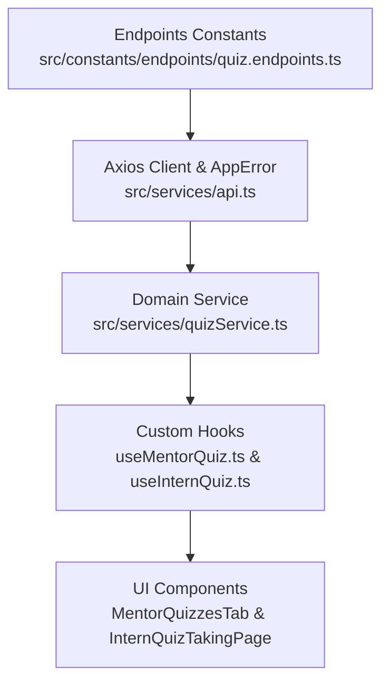

# Specification: Giao Diện Tạo Bài Quiz Bằng AI Cho Mentor & Trải Nghiệm Thi Trắc Nghiệm Cho Thực Tập Sinh (TM-104 Frontend)

> **Tài liệu Đặc Tả Kỹ Thuật (Frontend Specification)**  
> **Dự án:** [InternHub-Frontend](file:///d:/codegym_final_project/InternHub-Frontend) (React 19, Vite, TypeScript, CSS Modules)  
> **Mã Jira Ticket:** [TM-104](https://robluccibn9935.atlassian.net/browse/TM-104) - *Mentor AI-Powered Quiz Generation, Review & Intern Exam Taking Experience*  
> **Trạng thái:** PROPOSED / PENDING APPROVAL  
> **Lưu trữ tại:** [`InternHub-Frontend/docs/specs/TM-104-mentor-ai-quiz-generation-and-intern-taking-spec.md`](file:///d:/codegym_final_project/InternHub-Frontend/docs/specs/TM-104-mentor-ai-quiz-generation-and-intern-taking-spec.md)  
> **Change Level:** **L3** (Tích hợp phân hệ Quiz toàn diện: AI Quiz Generation Copilot cho Mentor, Quiz Editor duyệt đề nháp, Modal phân công giao bài đồng bộ Kanban, Focus Exam Room làm bài thi bảo mật cho TTS, và Explanatory Result Review sau khi nộp bài).  
> **Tiêu chuẩn tuân thủ:** 35 Nguyên tắc bất biến ([`AGENTS.md`](file:///d:/codegym_final_project/InternHub-Frontend/AGENTS.md)), Quy chuẩn UX/UI ([`08-ui-ux-guidelines.md`](file:///d:/codegym_final_project/InternHub-Frontend/.agents/08-ui-ux-guidelines.md)) & Kỹ năng Thiết kế Giao diện Độc bản ([`frontend-design`](file:///d:/codegym_final_project/InternHub-Frontend/.agents/skills/frontend-design/SKILL.md)).

---

## 0. Nhật Ký Thay Đổi & Giải Trình Kỹ Thuật (Revision History & Change Rationale)

| Phiên bản | Ngày | Người thực hiện | Task / Jira | Loại thay đổi | Lý do & Giải trình kỹ thuật (Rationale) |
| :---: | :---: | :---: | :---: | :---: | :--- |
| **v1.0** | 2026-10-14 | AI Senior Frontend Pair-Programmer & User | `TM-104` | Tạo mới Đặc Tả | Khởi tạo tài liệu đặc tả kỹ thuật Frontend cho tính năng Mentor sử dụng AI tạo bài Quiz từ báo cáo tuần và giao cho TTS/nhóm TTS, đồng bộ thẻ Kanban; xây dựng trải nghiệm làm bài thi tĩnh tâm và đối soát kết quả chi tiết cho thực tập sinh theo quy chuẩn `frontend-design`. |
| **v1.1** | 2026-10-26 | AI Senior Frontend Pair-Programmer & User | `TM-104` | Tích hợp tạo Quiz vào Modal Giao Việc Kanban | Chuyển đổi luồng tạo đề: Nhúng nút `[✦ Tạo bài kiểm tra ôn tập AI]` vào trực tiếp trong modal `MissionItemModal` (khi giao task Kanban). Bổ sung popup nhập nhanh tham số (Số câu, độ khó, chủ đề bám theo task), tự động đính kèm Quiz vào Task Kanban. Dọn dẹp nút tạo đề lỗi cũ tại `MentorQuizzesTab`. |
| **v1.2** | 2026-10-26 | AI Senior Frontend Pair-Programmer & User | `TM-104` | Kiến Trúc Đa Luồng Chạy Ngầm Bất Đồng Bộ & Floating Progress Widget tương tự TM-103 | Tách luồng sinh câu hỏi AI sang chạy ngầm không chặn thao tác (Non-blocking Async Job). Khi bấm "Bắt đầu tạo câu hỏi" trong `AiQuizQuickModal`, modal đóng ngay lập tức, kích hoạt `startQuizJob` qua `AiJobContext`. Cửa sổ nổi `FloatingProgressWidget` góc phải dưới màn hình tự động hiển thị tiến độ 4 chặng (25% - 60% - 85% - 100%). Mentor hoàn toàn tự do tiếp tục soạn task Kanban hoặc chuyển trang. Khi hoàn tất, widget cung cấp nút "Đính kèm vào công việc" hoặc tự động liên kết vào task đang soạn thảo. |

---

## 1. Feature Overview (Tổng Quan Tính Năng)

- **Tên tính năng:** Hệ thống tạo bài Quiz bằng AI dành cho Mentor & Phòng thi trực tuyến bảo mật cho Thực tập sinh (Mentor AI Quiz Copilot & Intern Exam Taking Experience).
- **Hệ thống liên quan:**
  - **Frontend:** `InternHub-Frontend` (React 19, Vite, TypeScript, CSS Modules, Lucide React, Axios client).
  - **Backend API:** `intern-and-program-service` (Port `8082`) và `ServiceAI` (Port `8086`) định tuyến qua API Gateway (Port `8080`) tại các prefix `/api/quizzes/**` và `/api/interns/me/quizzes/**`.
- **Điểm truy cập trên giao diện (Entry Points):**
  - **Dành cho Mentor:**
    - Không gian quản lý chương trình: `MentorProgramWorkspace` -> Tab mới **"Bài kiểm tra Quiz"** (`MentorQuizzesTab.tsx`).
    - Nút tác vụ nhanh từ Tab Báo cáo tuần: `MentorWeeklyReportsTab` -> Nút *"Tạo Quiz ôn tập tuần này"* (AI Quiz Quick Action).
  - **Dành cho Thực tập sinh (TTS):**
    - Trang tổng hợp bài kiểm tra cá nhân: `/intern/quizzes` (`InternQuizListPage.tsx`) hiển thị danh sách bài Quiz được giao.
    - Thẻ nhiệm vụ Kanban trên `/intern/missions`: Click vào thẻ nhiệm vụ mang tiền tố `[Quiz]` sẽ điều hướng trực tiếp sang bài thi tương ứng.
    - Phòng thi trực tuyến tập trung (Focus Exam Room): `/intern/quizzes/:assignmentId/take` (`InternQuizTakingPage.tsx`).
    - Màn hình kết quả & đối soát chi tiết: `/intern/quizzes/submissions/:submissionId` (`InternQuizResultPage.tsx`).
- **Đối tượng người dùng & Phân quyền:**
  - `ROLE_MENTOR`, `ROLE_HR`, `ROLE_ADMIN`: Tạo đề AI, biên tập câu hỏi, giao bài thi, xem báo cáo thống kê kết quả.
  - `ROLE_INTERN`: Xem danh sách bài Quiz được giao, làm bài thi trực tuyến, xem lại đáp án sau khi nộp.

---

## 2. Business Goals & User Stories (Mục Tiêu Nghiệp Vụ)

### 2.1. Mục tiêu nghiệp vụ (Business Goals)
1. **Tiết kiệm 90% thời gian soạn đề thi cho Mentor:** Thay vì phải tự nghĩ câu hỏi, Mentor chỉ cần chọn nhóm và tuần thực tập, AI tự động đọc kiến thức đã học từ báo cáo tuần để sinh bộ câu hỏi sát thực tế.
2. **Quy trình kiểm duyệt đề 2 bước (Human-in-the-loop):** AI chỉ sinh đề nháp (`DRAFT`). Mentor kiểm duyệt, sửa đổi câu hỏi/đáp án, bổ sung lời giải thích trước khi chính thức xuất bản và giao bài.
3. **Phân phối linh hoạt & Tự động hóa Kanban:** Cho phép giao bài cho 1 TTS (`INDIVIDUAL`) hoặc cả nhóm (`GROUP`), tự động sinh thẻ Kanban `[Quiz]` để TTS theo dõi deadline liền mạch.
4. **Bảo mật tuyệt đối đáp án thi:** Ẩn hoàn toàn đáp án đúng trong quá trình làm bài. Chỉ khi TTS hoàn thành nộp bài thì hệ thống mới mở khóa đáp án và lời giải chi tiết.
5. **Thuật toán chấm điểm chuẩn All-or-Nothing:** Với câu hỏi chọn nhiều đáp án (`MULTIPLE_CHOICE`), TTS phải chọn đúng và đủ tất cả đáp án đúng mới được điểm câu đó, rèn luyện tính chính xác cao.
6. **Kiểm soát số lần thi tối đa (`maxAttempts`):** Mentor cấu hình số lần được làm lại, hệ thống tự động ghi nhận điểm cao nhất cho TTS.

### 2.2. User Stories
- **Mentor Story 1 (Tạo đề AI):** *"Là một Mentor, tôi muốn chọn nhóm thực tập và tuần báo cáo để AI sinh ra 5-10 câu hỏi trắc nghiệm ôn tập, giúp tôi kiểm tra nhanh kiến thức các bạn đã tiếp thu trong tuần."*
- **Mentor Story 2 (Kiểm duyệt đề):** *"Là một Mentor, tôi muốn xem lại danh sách câu hỏi AI vừa tạo, có thể bấm sửa nội dung câu hỏi, đổi đáp án đúng hoặc thêm câu hỏi mới trước khi phát hành đề thi."*
- **Mentor Story 3 (Giao bài & Thống kê):** *"Là một Mentor, tôi muốn giao bài thi cho 1 nhóm TTS kèm hạn nộp và số lần làm bài tối đa, sau đó xem được bảng điểm chi tiết của từng em và tỷ lệ đạt của cả nhóm."*
- **Intern Story 1 (Làm bài thi):** *"Là một Thực tập sinh, tôi muốn nhận được bài Quiz trên Kanban hoặc trang Quiz của mình, bấm vào làm bài trong môi trường tập trung có đồng hồ đếm ngược rõ ràng."*
- **Intern Story 2 (Đối soát kết quả):** *"Là một Thực tập sinh, sau khi nộp bài tôi muốn biết ngay điểm số của mình, và được xem lại từng câu hỏi kèm đáp án đúng và lời giải thích chi tiết để học hỏi từ lỗi sai."*

---

## 3. Khảo Sát Hiện Trạng & Đánh Giá Tái Sử Dụng Mã Nguồn (Mandatory Scan & Reuse Assessment)

> [!IMPORTANT]
> Tuân thủ triệt để Chỉ thị cốt lõi: **"ĐẢM BẢO SẼ QUÉT DỰ ÁN, TRÁNH VIỆC TẠO THÊM CODE MỚI KHÔNG CẦN THIẾT, SỬ DỤNG TỐI ĐA NHỮNG GÌ ĐÃ CÓ ĐỂ PHÁT TRIỂN"** (Rule 16).

### 3.1. Các thành phần Frontend hiện hữu được tái sử dụng 100%:
1. **Hạ tầng Giao tiếp API & Authentication:**
   - [`api.ts`](file:///d:/codegym_final_project/InternHub-Frontend/src/services/api.ts): Axios Client 4 tầng đã cấu hình sẵn Bearer token, refresh token và chuẩn hóa lỗi `AppError`.
   - [`endpoints/index.ts`](file:///d:/codegym_final_project/InternHub-Frontend/src/constants/endpoints/index.ts): Tích hợp domain endpoints mới `QUIZ_ENDPOINTS`.
2. **Common UI Components (`src/components/common/`):**
   - [`Button`](file:///d:/codegym_final_project/InternHub-Frontend/src/components/common/Button/Button.tsx): Tái sử dụng các variants (`primary`, `secondary`, `outline`, `danger`, `ghost`, kích thước `sm`, `md`, `lg`) với spinner loader chống double-click.
   - [`Modal`](file:///d:/codegym_final_project/InternHub-Frontend/src/components/common/Modal/Modal.tsx): Tái sử dụng cấu trúc 3 khối (Header cố định, Body cuộn độc lập, Sticky Footer cố định đáy) cho tất cả các modal Quiz.
   - [`Input`](file:///d:/codegym_final_project/InternHub-Frontend/src/components/common/Input/Input.tsx) & [`Select`](file:///d:/codegym_final_project/InternHub-Frontend/src/components/common/Select/Select.tsx): Tái sử dụng các form controls có hỗ trợ `error?: string` và hiệu ứng focus border đổi màu sang `var(--primary)` kèm glow.
   - [`Skeleton`](file:///d:/codegym_final_project/InternHub-Frontend/src/components/common/Skeleton/Skeleton.tsx): Dùng cho trạng thái tải dữ liệu đề thi và bảng điểm (Rule 33).
   - [`Alert`](file:///d:/codegym_final_project/InternHub-Frontend/src/components/common/Alert/Alert.tsx): Dùng hiển thị lưu ý làm bài và cảnh báo All-or-Nothing.
3. **Thư viện Thông báo & Biểu tượng:**
   - `sonner`: Toast thông báo thành công / lỗi tức thời (`toast.success`, `toast.error`).
   - `lucide-react`: Sử dụng các icon quen thuộc trong dự án (`Sparkles`, `BrainCircuit`, `CheckCircle2`, `XCircle`, `Clock`, `Award`, `AlertCircle`, `ChevronLeft`, `ChevronRight`, `Play`, `Send`, `Edit3`, `Trash2`, `Users`, `User`, `FileCheck`).
4. **Hàm tiện ích Định dạng (`src/utils/formatters.ts`):**
   - Tái sử dụng hàm format ngày tháng, thời lượng phút, điểm số thập phân (Rule 23).
5. **Layouts & Workspace hiện hữu:**
   - [`MentorProgramWorkspace.tsx`](file:///d:/codegym_final_project/InternHub-Frontend/src/pages/mentor/missions/components/MentorProgramWorkspace/MentorProgramWorkspace.tsx): Tích hợp Tab thứ 4 `quizzes` vào hệ thống tab hiện tại.
   - [`MentorWeeklyReportsTab.tsx`](file:///d:/codegym_final_project/InternHub-Frontend/src/pages/mentor/missions/components/MentorProgramWorkspace/tabs/MentorWeeklyReportsTab.tsx): Thêm nút thao tác nhanh *"Tạo Quiz từ báo cáo này"*.
6. **Hạ Tầng Tác Vụ Ngầm & Cửa Sổ Tiến Độ Nổi (Async Background & Floating Widget tương tự TM-103):**
   - [`AiJobContext.tsx`](file:///d:/codegym_final_project/InternHub-Frontend/src/contexts/AiJobContext.tsx): Context toàn cục quản lý đa luồng chạy ngầm, mở rộng thêm kiểu tác vụ `jobType: 'QUIZ'`. Tự động polling ngầm trạng thái mỗi 2000ms mà không làm gián đoạn thao tác người dùng.
   - [`FloatingProgressWidget.tsx`](file:///d:/codegym_final_project/InternHub-Frontend/src/components/common/FloatingProgressWidget/FloatingProgressWidget.tsx): Tái sử dụng 100% cửa sổ nổi đa năng góc phải dưới màn hình (hỗ trợ cả dạng Collapsed Pill và Expanded Card) để hiển thị tiến độ 4 chặng của bài Quiz AI kèm nút bấm thao tác nhanh.

### 3.2. Các thành phần tạo mới theo chuẩn Domain-Driven Modular:
1. `src/constants/endpoints/quiz.endpoints.ts`: Khai báo tập trung URL endpoints Quiz của cả Mentor và Intern.
2. `src/constants/routes/quiz.routes.ts`: Khai báo tập trung các đường dẫn route Quiz của Intern.
3. `src/types/quiz.types.ts`: Khai báo 100% TypeScript interfaces khớp với contract Backend (Quiz, Question, Option, Assignment, Submission, Report).
4. `src/services/quizService.ts`: Tầng Axios service gọi API Quiz với đầy đủ `AbortSignal`.
5. `src/hooks/useMentorQuiz.ts`: Custom Hook quản lý logic sinh đề AI, duyệt đề, giao bài và thống kê của Mentor.
6. `src/hooks/useInternQuiz.ts`: Custom Hook quản lý danh sách bài được giao, trạng thái làm bài, countdown timer và nộp bài.
7. Thư mục giao diện Mentor: `src/pages/mentor/missions/components/MentorProgramWorkspace/tabs/MentorQuizzesTab/` và các sub-components/modals.
8. Thư mục giao diện Thực tập sinh: `src/pages/intern/quiz/` gồm danh sách bài, phòng thi tập trung và trang đối soát kết quả.

---

## 4. Ngôn Ngữ Thiết Kế Độc Bản (Bespoke Visual Design theo `frontend-design`)

> [!NOTE]
> Triết lý thiết kế: **"Ground your designs in the subject matter"** & **"Spend your boldness in one place"**. Giao diện Quiz không dùng các template SaaS nhạt nhòa, mà mang phong cách hiện đại của một phòng thi trực tuyến cao cấp, tập trung cao độ, kết hợp năng lực Copilot thông minh của AI.

### 4.1. Hệ thống Tokens Màu Sắc Ngữ Nghĩa (Semantic Tokens)
*Tuyệt đối không hardcode mã màu Hex trong CSS Modules (Rule 29)*:
- **AI Copilot Accent (Hào quang AI):** `var(--primary)` (#4f46e5) kết hợp `var(--primary-glow)` (rgba(79, 70, 229, 0.25)) tạo điểm nhấn thông minh khi AI đang sinh câu hỏi.
- **Thành công / Đáp án đúng (`PASS` / `CORRECT`):**
  - Viền & Chữ: `var(--success)` (#10b981)
  - Nền mờ: `var(--success-bg)` (rgba(16, 185, 129, 0.08))
- **Cảnh báo / Cận kề hết giờ (`TIME_WARNING`):**
  - Viền & Chữ: `var(--warning)` (#f59e0b)
  - Nền mờ: `var(--warning-bg)` (rgba(245, 158, 11, 0.08))
- **Không đạt / Đáp án sai (`FAIL` / `INCORRECT`):**
  - Viền & Chữ: `var(--danger)` (#ef4444)
  - Nền mờ: `var(--danger-bg)` (rgba(239, 68, 68, 0.08))
- **Thẻ Lựa Chọn Trắc Nghiệm (Tactile Option Card):**
  - Trạng thái mặc định: Nền `var(--bg-card)`, viền `var(--border-default)`, chữ `var(--text-main)`.
  - Trạng thái Hover: Viền chuyển sang `var(--border-focus)`, nền chuyển nhẹ sang `var(--bg-card-hover)`.
  - Trạng thái Selected: Viền đổi sang `var(--primary)` đậm, hiệu ứng ánh sáng `0 0 0 2px var(--primary-glow)`, huy hiệu chữ cái A/B/C/D đổi màu nền `var(--primary)` chữ trắng.

### 4.2. Hệ Thống Phân Cấp Kiểu Chữ (Typography Scale)
- Tiêu đề phòng thi / Kết quả: `font-size: 24px`, `font-weight: 700`, `letter-spacing: -0.02em`.
- Nội dung câu hỏi: `font-size: 18px`, `font-weight: 600`, `line-height: 1.5`, tương phản cao đạt chuẩn WCAG AA.
- Nội dung các lựa chọn A, B, C, D: `font-size: 15px`, `font-weight: 500`, dễ đọc, không bị zoom trên thiết bị di động.
- Lời giải thích (`explanation`): `font-size: 14px`, `line-height: 1.6`, nền xám nhạt/xanh nhạt bo góc tinh tế.

### 4.3. Layout Wireframes (Bản Vẽ Bố Cục ASCII)

#### A. Mentor Workspace - Tab "Bài Kiểm Tra Quiz" (`MentorQuizzesTab`)
```text
+-----------------------------------------------------------------------------------------+
| [Thống kê tổng quan]                                                                    |
| +-------------------+ +-------------------+ +-------------------+ +-------------------+ |
| | Tổng bài Quiz: 12 | | Đang mở thi: 4    | | Lượt đã thi: 86   | | Tỷ lệ Đạt: 88.4%  | |
| +-------------------+ +-------------------+ +-------------------+ +-------------------+ |
|                                                                                         |
| [Thanh tác vụ & Bộ lọc]                                                                 |
| [ Tìm kiếm bài Quiz... ]  [ Tất cả trạng thái v ]   [ + Tạo thủ công ] [ ✨ AI Tạo Quiz ] |
|                                                                                         |
| [Danh sách bài Quiz - Dạng Bento Grid Cards]                                            |
| +-----------------------------------------+ +-----------------------------------------+ |
| | [DRAFT] [MEDIUM]                        | | [PUBLISHED] [EASY]                      | |
| | Bài Quiz Java Core & Collections        | | Spring Boot REST API & JWT Security     | |
| | 10 câu hỏi · 15 phút · Điểm đạt 70/100  | | 8 câu hỏi · 20 phút · Điểm đạt 80/100   | |
| | Sinh từ báo cáo tuần 2 (Nhóm Backend)   | | Đã giao cho: Nhóm Java K28 (4 bạn)      | |
| |                                         | | Hoàn thành: 4/4 TTS · Điểm TB: 85.0     | |
| | [ Xem/Sửa đề ]   [ Giao bài thi ]       | | [ Xem kết quả ]   [ Thao tác v ]        | |
| +-----------------------------------------+ +-----------------------------------------+ |
+-----------------------------------------------------------------------------------------+
```

#### B. Modal Sinh Đề Thi Bằng AI Của Mentor (`AiQuizGeneratorModal`)
```text
+-----------------------------------------------------------------------------------------+
| ✨ Tạo Bài Quiz Tự Động Bằng Trí Tuệ Nhân Tạo (AI Copilot)                          [X] |
+-----------------------------------------------------------------------------------------+
| Chọn ngữ cảnh thực tập để AI đọc báo cáo và sinh câu hỏi trắc nghiệm bám sát:           |
|                                                                                         |
| * Nhóm thực tập sinh:                                                                   |
| [ [ Nhóm 1 - Java Backend ]                                                          v ] |
|                                                                                         |
| * Tuần báo cáo cần ôn tập:                                                              |
| [ Tuần 2: 12/10 - 18/10 (Tìm hiểu Spring Security, JWT, Filter chain)                v ] |
| [i] AI sẽ trích xuất 2 báo cáo đã nộp của nhóm để làm đề ôn tập kiến thức tuần này.    |
|                                                                                         |
| Chủ đề trọng tâm (tùy chọn):                                                            |
| [ Spring Security Filters & Authentication                                            ] |
|                                                                                         |
| * Số lượng câu hỏi: [ 5 câu  ] [ 10 câu (Khuyên dùng) ] [ 15 câu ]                      |
| * Độ khó:           [ Cơ bản (Easy) ] [ Trung bình (Medium) ] [ Nâng cao (Hard) ]       |
+-----------------------------------------------------------------------------------------+
| [ Hủy bỏ ]                                                    [ ✨ Bắt đầu sinh đề AI ] |
+-----------------------------------------------------------------------------------------+
```

#### C. Thực Tập Sinh - Phòng Thi Trực Tuyến Tập Trung (Focus Exam Room)
```text
+-----------------------------------------------------------------------------------------+
| INTERNHUB EXAM ROOM          Bài Quiz: Java Core & Collections          [ ⏱️ 14:32 ]    |
| Tiến độ: Câu 3 / 10  [======================-----------------------] 30%               |
+-----------------------------------------------------------------------------------------+
|                                                                                         |
| Câu hỏi 3:                                               [ CHỌN NHIỀU ĐÁP ÁN (ALL-OR-NOTHING) ]
| Những Interface nào sau đây kế thừa trực tiếp từ java.util.Collection?                  |
| (5 điểm)                                                                                |
|                                                                                         |
| [ ] A. java.util.List                                                                   |
|     Tập hợp có thứ tự và cho phép phần tử trùng lặp                                     |
|                                                                                         |
| [ ] B. java.util.Map                                                                    |
|     Cấu trúc ánh xạ Key - Value                                                         |
|                                                                                         |
| [X] C. java.util.Set                                                                    |
|     Tập hợp các phần tử không trùng lặp                                                 |
|                                                                                         |
| [ ] D. java.util.Queue                                                                  |
|     Hàng đợi xử lý theo cơ chế FIFO                                                     |
|                                                                                         |
| [!] Lưu ý: Câu hỏi nhiều đáp án yêu cầu chọn đúng và đủ tất cả các đáp án đúng để được  |
|     điểm. Chọn thiếu hoặc chọn thừa sẽ không nhận được điểm (0 điểm).                   |
|                                                                                         |
+-----------------------------------------------------------------------------------------+
| [ <- Câu trước ]      [ 1 ] [ 2 ] [ (3) ] [ 4 ] [ 5 ] ... [ 10 ]        [ Câu tiếp -> ] |
|                                                                         [ Nộp bài thi ] |
+-----------------------------------------------------------------------------------------+
```

#### D. Thực Tập Sinh - Màn Hình Kết Quả & Đối Soát Lời Giải Chi Tiết
```text
+-----------------------------------------------------------------------------------------+
| [ HERO KẾT QUẢ BÀI THI ]                                                                |
|                                                                                         |
|                            🎉 CHÚC MỪNG BẠN ĐÃ ĐẠT!                                     |
|                              Điểm số: 85 / 100                                          |
|                          (Đạt chuẩn: >= 70 điểm · 85.0%)                                |
|                                                                                         |
| Lượt thi: 1/2 · Thời gian làm: 11 phút 40 giây · Nộp lúc: 14:15 14/10/2026             |
| [ Làm lại bài thi (Còn 1 lượt) ]                                 [ Về trang bài Quiz ]  |
+-----------------------------------------------------------------------------------------+
|                                                                                         |
| ĐỐI SOÁT CHI TIẾT CÂU HỎI & LỜI GIẢI                                                    |
|                                                                                         |
| Câu 1: Từ khóa nào trong Java dùng để khai báo hằng số? [ĐÚNG +10 điểm]                 |
|   (o) A. final          <-- Lựa chọn của bạn [CHÍNH XÁC]                                |
|   ( ) B. const                                                                          |
|   ( ) C. static                                                                         |
|   ( ) D. immutable                                                                      |
|   💡 Lời giải thích: Trong Java, từ khóa `final` áp dụng cho biến sẽ ngăn chặn việc gán  |
|       lại giá trị, biến nó thành hằng số.                                               |
|                                                                                         |
| Câu 2: Interface nào thuộc Java Collection? [SAI 0/10 điểm - Thiếu đáp án]              |
|   [x] A. List           <-- Lựa chọn của bạn [ĐÁP ÁN ĐÚNG]                              |
|   [ ] B. Map                                                                            |
|   [ ] C. Set            <-- Bạn đã bỏ sót [ĐÁP ÁN ĐÚNG]                                 |
|   💡 Lời giải thích: List và Set đều kế thừa Collection. Vì đây là câu hỏi All-or-     |
|       Nothing, bạn cần chọn cả A và C mới được trọn vẹn điểm.                           |
+-----------------------------------------------------------------------------------------+
```

---

## 5. Kiến Trúc Luồng Dữ Liệu & Gọi API 4 Tầng (Axios 4-Layer Architecture)

Tuân thủ nghiêm ngặt **Rule 19 (Chuẩn mực kiến trúc gọi API 4 tầng)**:



### 5.1. Tầng 1: Endpoints Constants (`src/constants/endpoints/quiz.endpoints.ts`)
```typescript
export const QUIZ_ENDPOINTS = {
  // Mentor endpoints
  GENERATE_AI: '/api/quizzes/generate-ai',
  CREATE: '/api/quizzes',
  UPDATE: (id: number | string) => `/api/quizzes/${id}`,
  DETAIL: (id: number | string) => `/api/quizzes/${id}`,
  BY_PROGRAM: (programId: number | string) => `/api/quizzes/program/${programId}`,
  ASSIGN: (id: number | string) => `/api/quizzes/${id}/assign`,
  REPORT: (id: number | string) => `/api/quizzes/${id}/report`,

  // Intern endpoints
  MY_ASSIGNMENTS: '/api/interns/me/quizzes/assignments',
  START_ATTEMPT: (assignmentId: number | string) => `/api/interns/me/quizzes/assignments/${assignmentId}/start`,
  SUBMIT_ATTEMPT: (submissionId: number | string) => `/api/interns/me/quizzes/submissions/${submissionId}/submit`,
  SUBMISSION_RESULT: (submissionId: number | string) => `/api/interns/me/quizzes/submissions/${submissionId}`,
} as const;
```

### 5.2. Tầng 2: Data Transfer Objects & Interfaces (`src/types/quiz.types.ts`)
Khớp 100% với Backend Java:
- Enums: `QuizStatus` (`DRAFT`, `PUBLISHED`, `ARCHIVED`), `QuestionType` (`SINGLE_CHOICE`, `MULTIPLE_CHOICE`), `QuizDifficulty` (`EASY`, `MEDIUM`, `HARD`), `AssignmentTargetType` (`INDIVIDUAL`, `GROUP`), `SubmissionStatus` (`IN_PROGRESS`, `SUBMITTED`, `TIMED_OUT`).
- Request Interfaces:
  - `GenerateAiQuizRequest`: `{ programId: number; groupId?: number; weekNumber?: number; topic?: string; questionCount?: number; difficulty?: QuizDifficulty }`
  - `AssignQuizRequest`: `{ targetType: AssignmentTargetType; targetId: number; dueDate: string; timeLimitMinutes?: number; passingScore?: number; maxAttempts?: number; createKanbanTask?: boolean }`
  - `SubmitQuizRequest`: `{ answers: Array<{ questionId: number; selectedOptionIds: number[] }> }`
- Response Interfaces:
  - `QuizDetailResponse`: Thông tin đề thi kèm danh sách câu hỏi và lựa chọn đầy đủ (dành cho Mentor duyệt).
  - `QuizTakingResponse`: Dữ liệu bài thi gửi cho TTS (**Tuyệt đối không chứa `isCorrect`**).
  - `QuizResultResponse`: Kết quả điểm số, cờ `passed`, và `answerResults` kèm đáp án đúng và `explanation` (mở khóa sau khi submit).
  - `QuizReportResponse`: Thống kê tổng số giao, số hoàn thành, điểm trung bình, danh sách học viên.

### 5.3. Tầng 3: Domain Service (`src/services/quizService.ts`)
Tất cả các method đều hỗ trợ tham số `signal?: AbortSignal` để hủy request kịp thời khi component unmount:
- `generateAiQuiz(payload, signal)`
- `createQuiz(payload, signal)`
- `updateQuiz(id, payload, signal)`
- `getQuizDetail(id, signal)`
- `getQuizzesByProgram(programId, signal)`
- `assignQuiz(id, payload, signal)`
- `getQuizReport(id, signal)`
- `getMyAssignments(signal)`
- `startQuizAttempt(assignmentId, signal)`
- `submitQuizAttempt(submissionId, payload, signal)`
- `getSubmissionResult(submissionId, signal)`

### 5.4. Tầng 4: Custom Hooks (`useMentorQuiz.ts` & `useInternQuiz.ts`)
- **`useMentorQuiz(programId)`**:
  - Quản lý danh sách bài Quiz theo chương trình.
  - Xử lý mutation: `handleGenerateAi`, `handleUpdateQuiz`, `handleAssignQuiz`.
  - Quản lý trạng thái modal (AI Generator, Editor, Assign, Report).
  - Không vượt quá 3-4 states bằng cách gom State Object hoặc tách sub-hooks.
- **`useInternQuiz()`**:
  - Quản lý danh sách bài thi được giao.
  - Quản lý trạng thái làm bài thi: câu hỏi hiện tại (`currentQuestionIndex`), câu trả lời đã tick (`answersMap: Record<number, number[]>`), thời gian đếm ngược (`timeLeftSeconds`), trạng thái nộp bài.

---

## 6. Chi Tiết Giao Diện & Trải Nghiệm Người Dùng (UI/UX Breakdown)

### 6.1. Phân hệ Mentor (`/mentor/missions`)

#### A. Tab `MentorQuizzesTab.tsx`
- Đặt tại `src/pages/mentor/missions/components/MentorProgramWorkspace/tabs/MentorQuizzesTab/`.
- **Thanh Header:**
  - Tiêu đề: *"Ngân Hàng Bài Kiểm Tra Trắc Nghiệm (Quizzes)"*.
  - Nút bấm chính: Button `variant="primary"` có icon `Sparkles` mang tên **"✨ Tạo Quiz bằng AI"**.
  - Nút phụ: Button `variant="outline"` mang tên **"Tạo thủ công"**.
- **Lưới hiển thị Bento Cards:**
  - Mỗi thẻ bài Quiz hiển thị: Badge trạng thái (`Bản nháp DRAFT` - màu xám, `Đã giao PUBLISHED` - màu xanh lá), độ khó, số câu hỏi, thời gian làm bài, điểm đạt.
  - Nếu là bài AI: có huy hiệu nhỏ *"Tạo từ báo cáo tuần N"*.
  - Thao tác trên Card:
    - Nếu là `DRAFT`: Nút *"Chỉnh sửa đề"*, Nút *"Giao bài thi"*.
    - Nếu là `PUBLISHED`: Nút *"Xem báo cáo kết quả"*, Dropdown menu (Xem chi tiết, Lưu trữ).

#### B. Modal Sinh Đề Thi Bằng AI (`AiQuizGeneratorModal.tsx`)
- Cấu trúc 3 khối Modal:
  - Header: *"Tạo Bài Quiz Bằng AI (Gemini Copilot)"*.
  - Body:
    - Dropdown chọn Nhóm TTS trong kỳ thực tập.
    - Dropdown chọn Tuần báo cáo (tự động gợi ý tuần có báo cáo đã nộp).
    - Ô nhập Topic bổ sung (nếu muốn AI nhấn mạnh vào công nghệ cụ thể).
    - Segmented Buttons chọn số lượng câu hỏi: `5 câu`, `10 câu` (Khuyên dùng), `15 câu`.
    - Segmented Buttons chọn độ khó: `Cơ bản`, `Trung bình`, `Nâng cao`.
  - Footer ghim cố định đáy: Nút *"Hủy bỏ"*, Nút *"✨ Bắt đầu sinh đề AI"*.
- **Trạng thái AI đang sinh câu hỏi (Generating Shimmer Screen):**
  - Khi Mentor nhấn submit, Modal chuyển sang giao diện chờ với hiệu ứng shimmer viền glow tím xanh `var(--primary-glow)`.
  - Dòng trạng thái sinh động: *"Đang đọc báo cáo tuần của học viên..."* ➔ *"Gemini đang phân tích kiến thức và biên soạn câu hỏi trắc nghiệm..."* ➔ *"Đang hoàn tất đề thi nháp..."*.

#### C. Modal Kiểm Duyệt & Biên Tập Đề Thi Nháp (`QuizEditorModal.tsx`)
- Mở ngay sau khi AI sinh đề thành công (hoặc khi Mentor bấm *"Chỉnh sửa đề"*).
- Cho phép Mentor kiểm duyệt toàn diện:
  - Sửa tiêu đề, mô tả, thời gian làm bài (`timeLimitMinutes`), điểm đạt (`passingScore`).
  - Danh sách từng câu hỏi có thể mở rộng (Accordion):
    - Đổi loại câu hỏi: `SINGLE_CHOICE` (1 đáp án) hoặc `MULTIPLE_CHOICE` (nhiều đáp án).
    - Sửa text câu hỏi, sửa điểm số của câu.
    - Sửa nội dung các lựa chọn A, B, C, D; tick chọn đáp án nào là đúng (`isCorrect`).
    - Sửa lời giải thích chi tiết (`explanation`).
    - Nút *"Xóa câu hỏi"* hoặc *"Thêm câu hỏi mới"*.
- Footer: Nút *"Lưu bản nháp"*, Nút *"Lưu & Chuyển sang giao bài"*.

#### D. Modal Phân Công Giao Bài Thi (`AssignQuizModal.tsx`)
- Lựa chọn đối tượng:
  - Radio chọn **"Giao cho cả Nhóm"** (Dropdown chọn nhóm TTS).
  - Radio chọn **"Giao cho 1 Thực tập sinh cụ thể"** (Dropdown chọn học viên).
- Cấu hình đợt thi:
  - Hạn chót nộp bài (`dueDate`): Input DatePicker, giới hạn không quá ngày kết thúc kỳ thực tập.
  - Số lần làm lại tối đa (`maxAttempts`): Input Number (Mặc định: 1 hoặc 2 lượt).
  - Switch Toggle: **"Tự động tạo thẻ nhiệm vụ trên Kanban Board"** (Mặc định: ON).
- Footer: Nút *"Xác nhận giao bài"*.

#### E. Modal Báo Cáo Kết Quả Thi Của Nhóm (`QuizReportModal.tsx`)
- Thống kê dạng Bento 4 ô: Tổng số giao, Số TTS đã hoàn thành, Số TTS thi đạt, Điểm trung bình.
- Bảng danh sách kết quả học viên:
  - Cột: Mã TTS, Họ tên, Nhóm, Số lượt đã thi, Điểm cao nhất / Thang điểm, Kết quả (`ĐẠT` xanh lá / `CHƯA ĐẠT` đỏ), Thời điểm nộp gần nhất.

---

### 6.2. Phân hệ Thực tập sinh (`/intern/quizzes`)

#### A. Trang Danh Sách Bài Quiz Được Giao (`InternQuizListPage.tsx`)
- Route: `/intern/quizzes`.
- Hiển thị danh sách bài thi dưới dạng Bento Grid Cards:
  - Tiêu đề đề thi, môn/topic, thời lượng, hạn nộp.
  - Huy hiệu trạng thái:
    - `Chưa làm` (màu xanh dương): Nút *"Bắt đầu làm bài"*.
    - `Đang làm dở` (màu vàng): Nút *"Tiếp tục làm bài"*.
    - `Đã hoàn thành` (màu xanh lá): Hiển thị điểm số cao nhất, Nút *"Xem lời giải chi tiết"*, Nút *"Làm lại (còn N lượt)"*.

#### B. Màn Hình Phòng Thi Tĩnh Tâm Tập Trung (`InternQuizTakingPage.tsx`)
- Route: `/intern/quizzes/:assignmentId/take`.
- **Thiết kế Focus Room không phân tâm:**
  - Ẩn toàn bộ thanh Sidebar và Header cồng kềnh của Dashboard để TTS dồn 100% sự chú ý vào bài thi.
  - **Thanh Header phòng thi:**
    - Nút quay lại (có xác nhận cảnh báo).
    - Tiêu đề đề thi & Tiến độ câu hỏi: `Câu 3 / 10`.
    - **Đồng hồ đếm ngược (Countdown Timer):**
      - Mặc định: Màu trung tính `var(--text-main)`.
      - Khi còn dưới 3 phút: Đổi sang màu vàng `var(--warning)`.
      - Khi còn dưới 1 phút: Đổi sang màu đỏ `var(--danger)` kèm hiệu ứng nhịp tim pulsing nhẹ nhàng nhắc nhở TTS khẩn trương nộp bài.
      - Khi hết giờ (`00:00`): Tự động khóa thao tác và kích hoạt hàm nộp bài tự động.
  - **Body câu hỏi trắc nghiệm:**
    - Khối số thứ tự câu hỏi & Badge phân loại:
      - Nếu là Single Choice: Badge *"Chọn 1 đáp án"* kèm Radio tròn.
      - Nếu là Multiple Choice: Badge *"Chọn nhiều đáp án (All-or-Nothing)"* kèm Checkbox vuông, có dòng lưu ý nhỏ giải thích rõ luật chấm điểm.
    - Khung câu hỏi nổi bật, chữ to rõ ràng.
    - **Các ô lựa chọn (Option Cards):** Thiết kế dạng thẻ bo tròn, tương tác xúc giác cao, có phím tắt nhanh (nhấn 1, 2, 3, 4 hoặc A, B, C, D trên bàn phím để chọn nhanh).
  - **Thanh điều hướng câu hỏi (Question Navigation Dock):**
    - Hiển thị dãy nút số câu hỏi `1`, `2`, `3` ... `10`.
    - Câu đã chọn có màu nền `var(--primary)` chữ trắng; câu chưa chọn có viền xám; câu đang xem có viền sáng bao quanh.
  - **Footer ghim cố định đáy (Sticky Footer):**
    - Nút *"<- Câu trước"*, Nút *"Câu tiếp ->"*.
    - Nút nổi bật: **"Nộp bài thi"** (`variant="primary"`).

#### C. Modal Xác Nhận Nộp Bài (`SubmitConfirmModal.tsx`)
- Trước khi nộp bài, hiển thị bảng kiểm tra tóm tắt:
  - *"Bạn đã hoàn thành 8/10 câu hỏi. Còn 2 câu chưa chọn đáp án!"*
  - Nếu còn câu chưa làm, nút số các câu chưa làm hiển thị màu vàng để TTS click nhảy nhanh về câu đó.
  - Nút xác nhận: *"Xác nhận nộp bài"*.

#### D. Màn Hình Đối Soát Lời Giải Chi Tiết (`InternQuizResultPage.tsx`)
- Route: `/intern/quizzes/submissions/:submissionId`.
- **Hero Banner vinh danh kết quả:**
  - Vòng tròn điểm số ấn tượng: Ví dụ `85 / 100` điểm.
  - Huy hiệu: **ĐẠT (PASSED)** nền xanh lá hoặc **CHƯA ĐẠT** nền đỏ nhạt.
  - Thống kê chi tiết: Số câu đúng, số câu sai, thời gian làm bài, số lượt thi còn lại.
  - Nút bấm: *"Làm lại bài thi"* (nếu còn lượt), *"Quay lại danh sách bài Quiz"*.
- **Khu vực đối soát từng câu hỏi:**
  - Hiển thị lại toàn bộ câu hỏi.
  - Các lựa chọn của học viên được đánh dấu rõ:
    - Nếu chọn đúng: Viền xanh lá kèm icon check `CheckCircle2`.
    - Nếu chọn sai: Viền đỏ kèm icon `XCircle`.
    - Đáp án đúng của hệ thống: Đánh dấu viền xanh lá đậm kèm nhãn *"Đáp án chính xác"*.
  - **Khối lời giải thích chi tiết (`explanation`):** Hộp giải thích nền xanh lam nhạt `var(--primary-glow)`, cung cấp kiến thức cốt lõi giúp học viên nắm vững lý thuyết.

---

## 7. Xử Lý 5 Trạng Thái Giao Diện Bắt Buộc (5 States Matrix - Rule 33)

| Component / Màn hình | 1. Loading (Skeleton) | 2. Empty (Có CTA) | 3. Error (Có Retry) | 4. Success (Toast/Feedback) | 5. Disabled / In-Progress |
| :--- | :--- | :--- | :--- | :--- | :--- |
| **`MentorQuizzesTab`** | 6 thẻ Bento Skeleton dạng Shimmer lượn sóng | Icon hộp rỗng + Tiêu đề *"Chưa có bài Quiz nào"* + Nút CTA *"✨ Tạo Quiz đầu tiên bằng AI"* | Alert màu đỏ thông báo lỗi tải + Nút *"Thử lại"* | Toast xanh: *"Đã xuất bản và giao bài Quiz thành công"* | Nút giao bài chuyển sang trạng thái loading khi đang lưu |
| **`AiQuizGeneratorModal`** | Hiệu ứng Shimmer AI Copilot lượn sóng khi đang gọi Gemini | Báo lỗi nếu nhóm chưa có báo cáo tuần nào đã nộp | Alert chi tiết lỗi từ ServiceAI + Nút *"Thử lại"* | Đóng modal + Tự động mở Modal biên tập đề nháp | Khóa nút *"Bắt đầu sinh đề AI"* khi chưa chọn nhóm |
| **`InternQuizListPage`** | 4 thẻ Bento Card Skeleton | Icon cúp/tài liệu + *"Bạn chưa có bài Quiz nào được giao"* + Gợi ý xem nhiệm vụ Kanban | Alert lỗi kết nối + Nút *"Tải lại"* | N/A | Khóa nút *"Làm bài"* nếu đã quá hạn nộp |
| **`InternQuizTakingPage`** | Skeleton toàn màn hình mô phỏng khung câu hỏi | N/A (Đề thi luôn có ít nhất 1 câu) | Thông báo lỗi không tải được đề + Nút quay về danh sách | Modal chúc mừng kết quả + Mở khóa đối soát lời giải | Khi bấm nộp bài: Khóa toàn bộ lựa chọn, hiện spinner trên nút Nộp |
| **`InternQuizResultPage`** | Skeleton vòng tròn điểm số và các câu hỏi | N/A | Thông báo bài thi chưa hoàn thành hoặc không có quyền xem | Hiển thị trọn vẹn điểm số và huy hiệu ĐẠT/KHÔNG ĐẠT | Nút *"Làm lại bài"* bị vô hiệu hóa khi hết số lần thi |

---

## 8. Chiến Lược State Management & Tuân Thủ Rule 15

Tuân thủ nghiêm ngặt **Rule 15 (Giới hạn tối đa 3 - 4 State trong 1 Component)**:
- Trong `MentorQuizzesTab.tsx`:
  - Đưa toàn bộ state phân trang, bộ lọc và CRUD vào Custom Hook `useMentorQuiz`. Component chỉ nhận: `quizzes`, `loading`, `error`, `actions`.
- Trong `AiQuizGeneratorModal.tsx`:
  - Gom toàn bộ form inputs vào 1 State Object duy nhất:
    ```typescript
    interface AiGenFormState {
      groupId: number | null;
      weekNumber: number | null;
      topic: string;
      questionCount: number;
      difficulty: QuizDifficulty;
    }
    const [formData, setFormData] = useState<AiGenFormState>(initialFormState);
    const [isGenerating, setIsGenerating] = useState<boolean>(false);
    ```
    *(Chỉ 2 states, hoàn toàn tuân thủ Rule 15).*
- Trong `InternQuizTakingPage.tsx`:
  - Gom toàn bộ state phòng thi vào Custom Hook `useQuizExamSession`:
    - `currentQuestionIndex`: number
    - `userAnswers`: Record<number, number[]>
    - `timeLeftSeconds`: number
    - `isSubmitting`: boolean

---

## 9. Các Biện Pháp Bảo Mật & Toàn Vẹn Dữ Liệu Frontend

1. **Bảo mật tuyệt đối đáp án (Zero-Knowledge Frontend):**
   - DTO `QuizTakingResponse` từ Backend tuyệt đối không gửi trường `isCorrect`. Dev hay Intern mở F12 Network Tab hay React DevTools cũng không thể xem trước đáp án.
2. **Bảo toàn bài làm khi vô tình refresh (Auto-save Local Cache):**
   - Trong quá trình làm bài, mỗi khi TTS tick chọn đáp án, hook `useInternQuiz` tự động lưu tạm vào `sessionStorage` (`quiz_draft_${submissionId}`).
   - Nếu vô tình F5 hoặc mất mạng tạm thời, khi load lại trang hệ thống tự động khôi phục các câu trả lời đã tick.
3. **Cảnh báo rời phòng thi (`beforeunload` & Navigation Guard):**
   - Khi bài thi đang diễn ra, nếu người dùng click link ra ngoài hoặc đóng tab trình duyệt, hiển thị pop-up cảnh báo: *"Bài thi đang diễn ra! Bạn có chắc chắn muốn rời khỏi trang không?"*.
4. **Chống gian lận nộp bài đúp (Idempotent Submission):**
   - Nút *"Nộp bài thi"* tự động set `disabled` và hiện spinner loader ngay khi click lần đầu, triệt tiêu nguy cơ gửi 2 request cùng lúc.

---

## 10. Danh Mục File Sẽ Tạo Mới & Chỉnh Sửa (File Manifest)

### 10.1. Constants & Types:
- `src/constants/endpoints/quiz.endpoints.ts` (Tạo mới)
- `src/constants/routes/quiz.routes.ts` (Tạo mới)
- `src/constants/endpoints/index.ts` (Chỉnh sửa: export `QUIZ_ENDPOINTS`)
- `src/constants/routes/index.ts` (Chỉnh sửa: export `QUIZ_ROUTES`)
- `src/types/quiz.types.ts` (Tạo mới: Toàn bộ Enums & DTOs)

### 10.2. Services & Hooks:
- `src/services/quizService.ts` (Tạo mới: Axios client 4 tầng)
- `src/hooks/useMentorQuiz.ts` (Tạo mới: Hook quản lý nghiệp vụ Mentor)
- `src/hooks/useInternQuiz.ts` (Tạo mới: Hook quản lý phòng thi và làm bài TTS)

### 10.3. Giao diện Mentor:
- `src/pages/mentor/missions/components/MentorProgramWorkspace/tabs/MentorQuizzesTab/`
  - `MentorQuizzesTab.tsx` (Tạo mới: Tab danh sách bài Quiz)
  - `MentorQuizzesTab.module.css` (Tạo mới)
  - `MentorQuizzesTab.types.ts` (Tạo mới)
  - `components/AiQuizGeneratorModal/` (Modal sinh đề AI)
  - `components/QuizEditorModal/` (Modal kiểm duyệt & sửa đề nháp)
  - `components/AssignQuizModal/` (Modal giao bài thi & đồng bộ Kanban)
  - `components/QuizReportModal/` (Modal báo cáo điểm và thống kê)
- `src/pages/mentor/missions/components/MentorProgramWorkspace/MentorProgramWorkspace.tsx` (Chỉnh sửa: thêm tab `quizzes`)

### 10.4. Giao diện Thực tập sinh:
- `src/pages/intern/quiz/`
  - `InternQuizListPage.tsx` (Tạo mới: Danh sách bài Quiz được giao)
  - `InternQuizListPage.module.css` (Tạo mới)
  - `InternQuizTakingPage.tsx` (Tạo mới: Phòng thi tập trung Focus Exam Room)
  - `InternQuizTakingPage.module.css` (Tạo mới)
  - `InternQuizResultPage.tsx` (Tạo mới: Đối soát kết quả & lời giải chi tiết)
  - `InternQuizResultPage.module.css` (Tạo mới)
  - `components/SubmitConfirmModal/` (Modal xác nhận nộp bài)
- `src/App.tsx` (Chỉnh sửa: Đăng ký các routes `/intern/quizzes`, `/intern/quizzes/:assignmentId/take`, `/intern/quizzes/submissions/:submissionId`)

---

## 11. Kế Hoạch Kiểm Thử & Tiêu Chí Nghiệm Thu (Acceptance Criteria)

### 11.1. Tiêu chí nghiệm thu chức năng (Functional Acceptance Criteria)
- [ ] **AC-1 (AI Sinh đề):** Mentor chọn nhóm và tuần báo cáo, bấm *"Sinh đề AI"*, hệ thống gọi `POST /api/quizzes/generate-ai` và hiển thị bản nháp 5-10 câu hỏi trong vòng 3-5 giây.
- [ ] **AC-2 (Kiểm duyệt đề):** Mentor sửa được nội dung câu hỏi, đổi lựa chọn đáp án đúng, thêm câu hỏi mới, lưu đề thành công.
- [ ] **AC-3 (Giao bài & Kanban):** Mentor giao bài cho nhóm, thẻ nhiệm vụ `[Quiz] ...` xuất hiện trên Kanban Board của chương trình.
- [ ] **AC-4 (Bảo mật phòng thi):** Khi TTS bấm làm bài, DTO trả về không chứa `isCorrect`. Màn hình làm bài hiển thị đồng hồ đếm ngược chính xác.
- [ ] **AC-5 (Chấm điểm All-or-Nothing):** Với câu hỏi nhiều đáp án, nếu chọn thiếu hoặc thừa thì câu đó nhận 0 điểm; chọn đúng và đủ nhận trọn vẹn điểm câu.
- [ ] **AC-6 (Mở khóa đáp án sau khi nộp):** Sau khi nộp bài thành công, màn hình kết quả hiển thị điểm số, huy hiệu Đạt/Chưa đạt, và mở khóa đầy đủ đáp án đúng kèm lời giải thích chi tiết.
- [ ] **AC-7 (Chặn làm quá số lần):** Khi TTS đã hết số lượt thi cho phép (`attemptCount >= maxAttempts`), nút làm bài bị khóa và thông báo rõ ràng.

### 11.2. Tiêu chí nghiệm thu kỹ thuật & UX/UI (Non-Functional Criteria)
- [ ] 100% màu sắc dùng CSS Variables từ `src/index.css`, không hardcode mã Hex.
- [ ] Đạt chuẩn tương phản chữ WCAG AA (>= 4.5:1).
- [ ] Hiển thị đầy đủ 5 trạng thái giao diện (Skeleton loader dạng shimmer lượn sóng, Empty state có nút CTA, Error state có nút Retry).
- [ ] Không có component nào vượt quá 3-4 states (Rule 15).
- [ ] Clean code, không có warning/lint error từ ESLint/Oxlint.
- [ ] Tương thích responsive mượt mà từ màn hình Desktop (1920x1080) xuống Tablet và Mobile.
